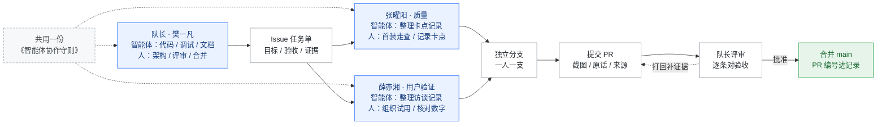
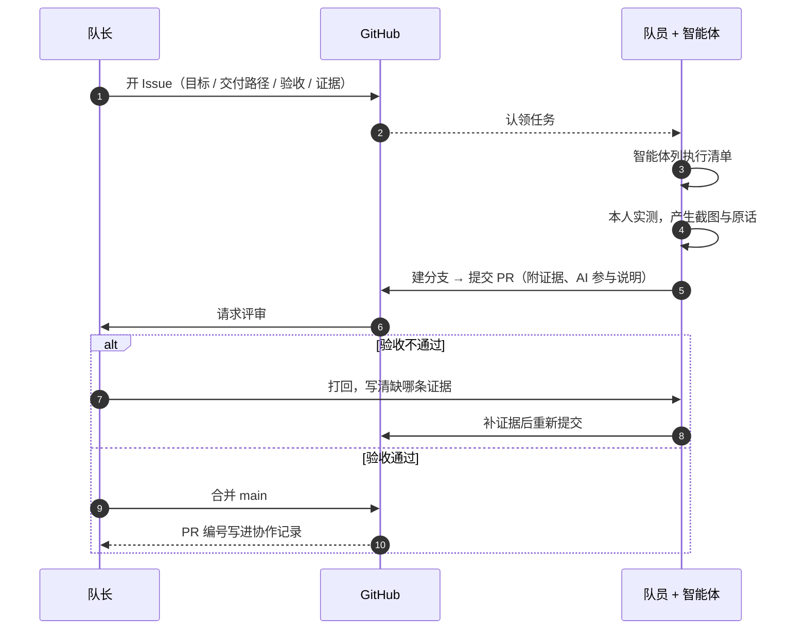

# 团队工作流（Mermaid 版）

> 同一个工作流的两张代码图。GitHub 的 `.md` 预览会直接渲染；VS Code 需要装 *Markdown Preview Mermaid Support*；也可以整段粘到 [mermaid.live](https://mermaid.live)。
> 优点：纯文本，可 diff、可评审、随仓库走。缺点：样式由渲染器决定，和 PPT 视觉不统一。
> 不想开 GitHub 也能看：[渲染预览图](figures/mermaid/工作流-mermaid-预览.png)。

## 一、分工与流转

## 二、一件任务的生命周期

## 三、和网页版的分工

| | Mermaid 版（本文件） | 网页版 `团队工作流.html` |
|---|---|---|
| 载体 | 纯文本，进仓库 | 单文件 HTML |
| 渲染 | GitHub / mermaid.live | 浏览器直接打开 |
| 视觉 | 渲染器默认，开发文档风 | 与 PPT v6 同一套深蓝 |
| 改动 | 改文字，diff 可评审 | 改 HTML |
| 适用 | 仓库内文档、评审、留档 | 答辩展示、PPT 插图 |